# Academic Figures & Legends: Orthodontic Appliance Aesthetic Perception Study

**Sample Size:** N = 33 official study evaluators (evaluated between Oct 22 and Oct 30, 2026).
**Guidelines:** Conforming to BMJ, Lancet, and Nature visual presentation and statistical reporting standards.

### Figure 1: Overall Aesthetic Attractiveness Ratings Across Orthodontic Appliances
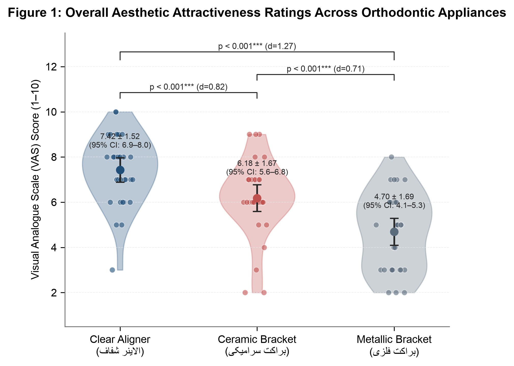

**Legend & Statistical Interpretation:** Violin plots with overlaid jittered individual observations, Mean ± 95% Confidence Intervals (error bars), and pairwise two-tailed Wilcoxon signed-rank test brackets with paired Cohen's d effect sizes.

---

### Figure 2: Visual Salience & Detraction: Device Noticeability vs Smile Degradation
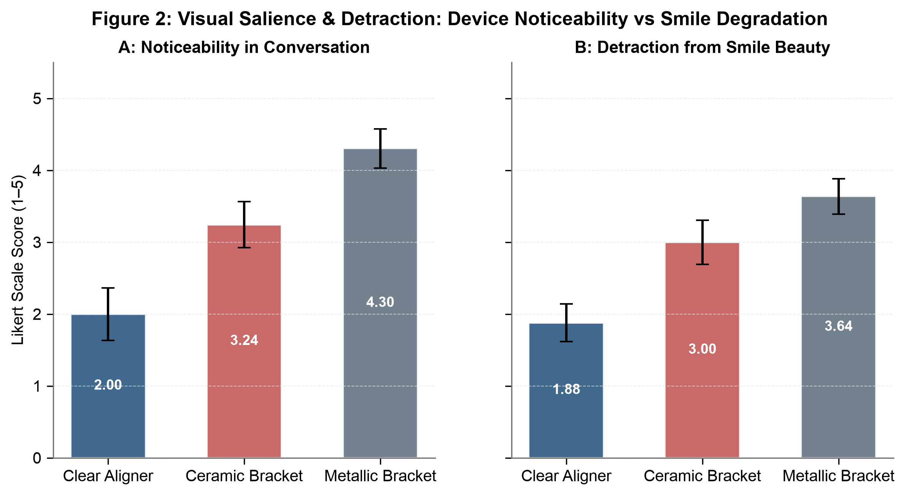

**Legend & Statistical Interpretation:** Dual-panel clustered bar chart comparing conversational noticeability against perceived visual detraction from smile beauty (Mean ± 95% CI).

---

### Figure 3: Psychometric Profile & Halo Effect Attribution Battery (1–5 Scales)
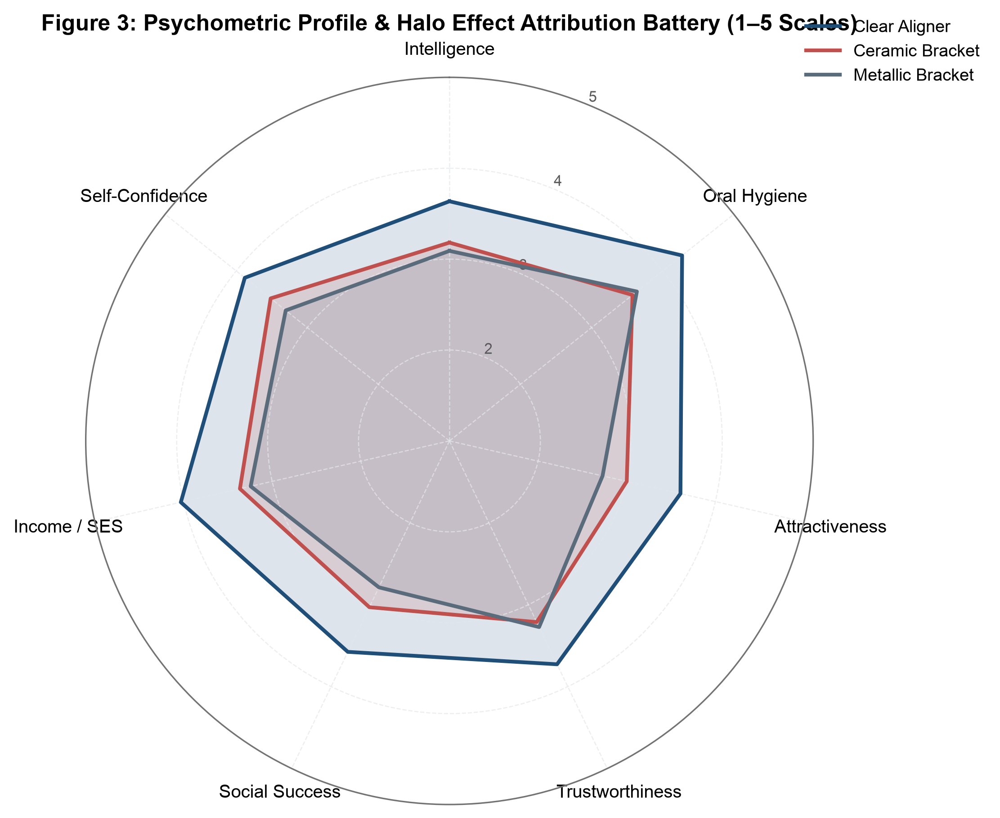

**Legend & Statistical Interpretation:** Seven-axis polar radar chart simultaneously comparing Clear Aligner, Ceramic Brackets, and Metallic Brackets across perceived Intelligence, Oral Hygiene, Attractiveness, Trustworthiness, Social Success, Socioeconomic Status, and Self-Confidence.

---

### Figure 4: Psychological Halo Effect: Effect Sizes Relative to Metallic Brackets
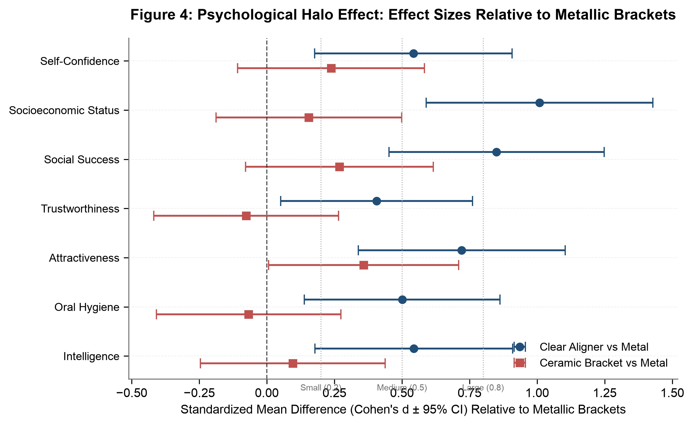

**Legend & Statistical Interpretation:** Forest plot displaying Standardized Mean Differences (Cohen's d with 95% CI) for Clear Aligner and Ceramic Brackets against Metallic Brackets baseline.

---

### Figure 5: Professional Workplace Appropriateness & Anticipated Embarrassment
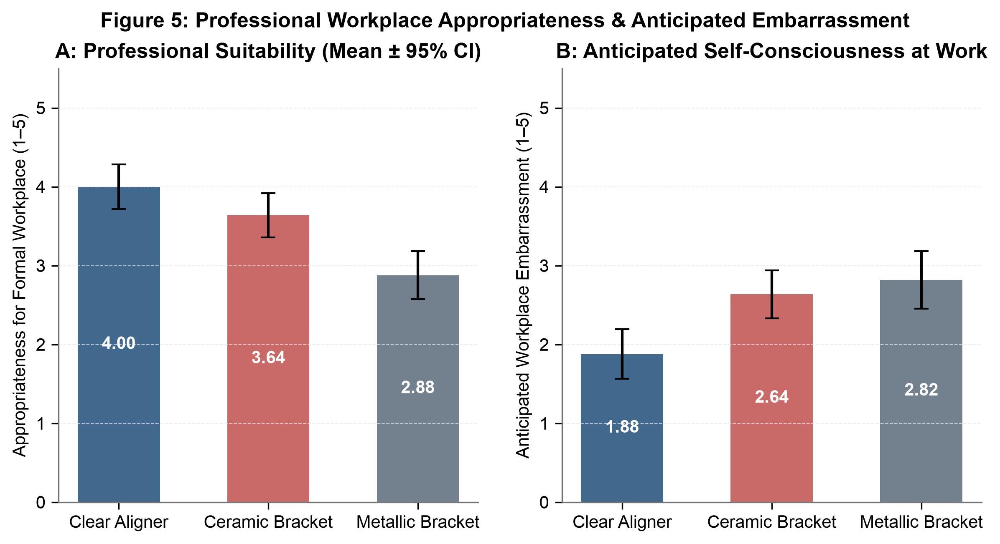

**Legend & Statistical Interpretation:** Clustered comparisons of professional setting suitability vs personal self-consciousness / embarrassment at work.

---

### Figure 6: Sequence Bias Analysis: VAS Attractiveness by Appliance Presentation Order
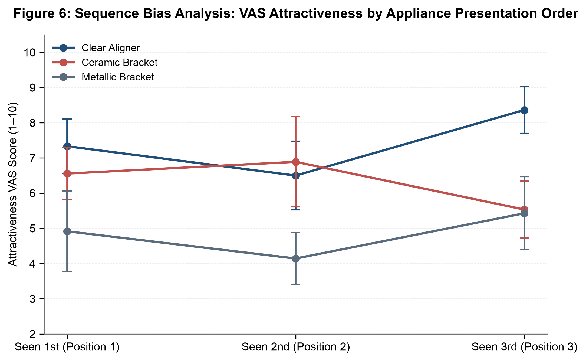

**Legend & Statistical Interpretation:** Two-way interaction plot showing mean VAS ratings depending on whether the appliance was evaluated in Position 1, 2, or 3, demonstrating absence of detrimental carryover or primacy bias.

---

### Figure 7: Randomization Uniformity Across 6 Presentation Permutations
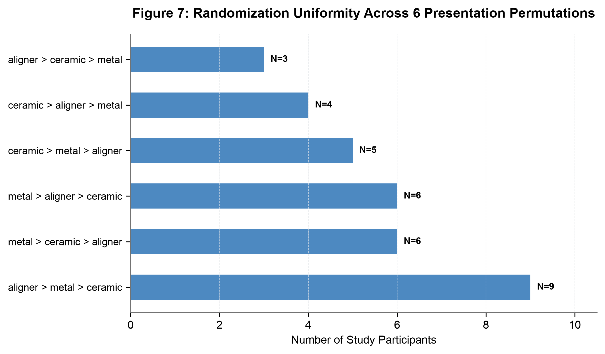

**Legend & Statistical Interpretation:** Horizontal frequency plot confirming balanced distribution across all six factorial order sequences.

---

### Figure 8: Sex-Stratified Appliance Attractiveness Ratings (Male vs Female Evaluators)
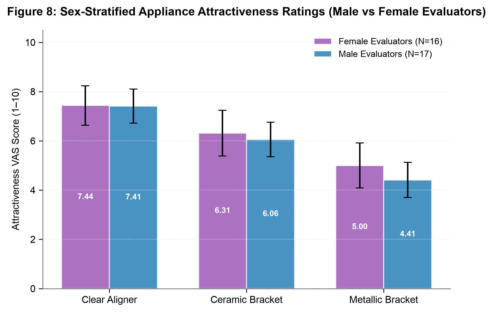

**Legend & Statistical Interpretation:** Clustered comparison testing whether male and female respondents perceive appliance aesthetics differently.

---

### Figure 9: Appliance Aesthetic Ratings Stratified by Evaluator Treatment History
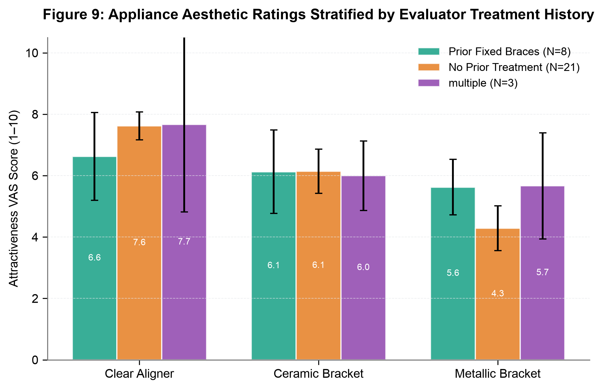

**Legend & Statistical Interpretation:** Subgroup comparison examining evaluations among respondents with prior fixed braces, no treatment, or multiple modalities.

---

### Figure 10: Spearman Inter-Correlation Matrix: Evaluator Priorities vs Ratings
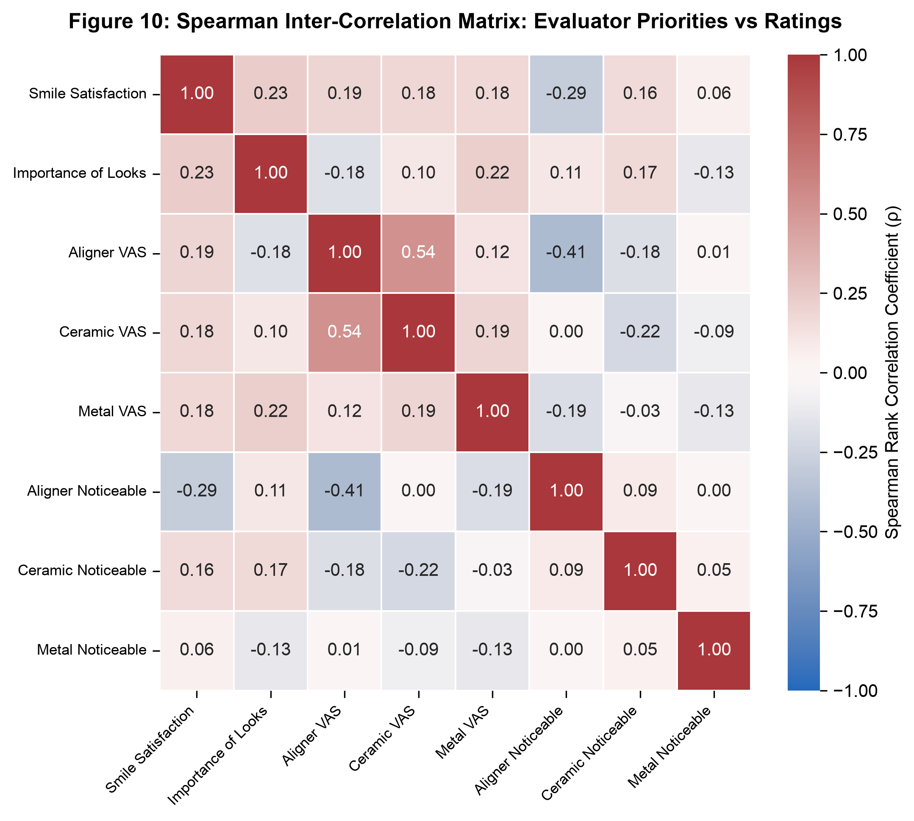

**Legend & Statistical Interpretation:** Correlation heatmap linking smile satisfaction and appearance importance with appliance ratings.

---

### Figure 11: Linear Regression & Correlation: Color Harmony vs Overall Attractiveness
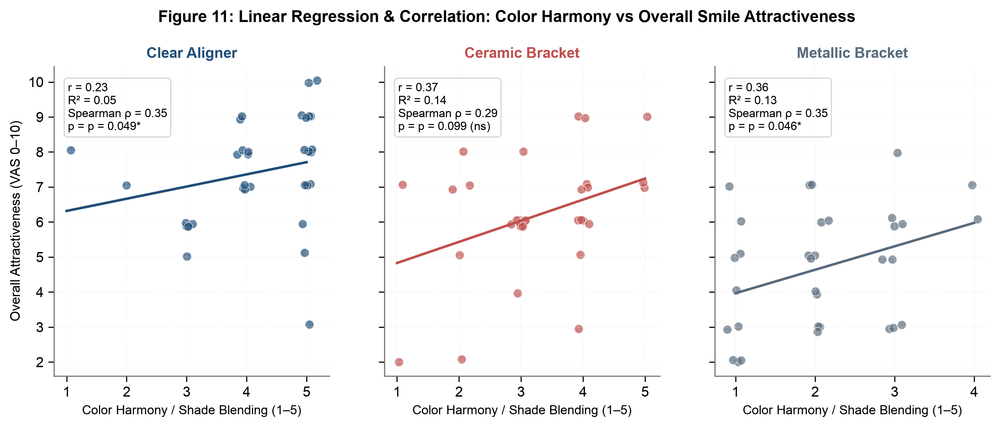

**Legend & Statistical Interpretation:** Multi-panel scatter plot with OLS linear regression fit and 95% confidence bands evaluating the exact visual contribution of color harmony / shade blending to overall smile attractiveness.

---

### Figure 12: Composite Personal Adoption & Social Readiness Index
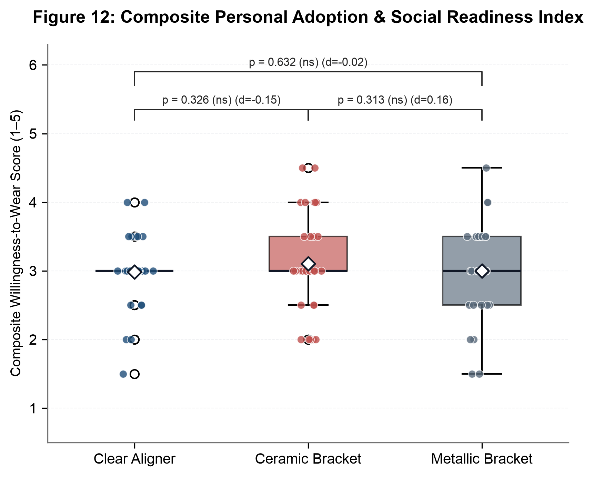

**Legend & Statistical Interpretation:** Boxplots with overlaid individual jittered scores, mean diamonds, and Wilcoxon signed-rank tests for a composite index combining workplace comfort and social event willingness.

---

### Figure 13: Age Cohort Stratification of Appliance Attractiveness Ratings
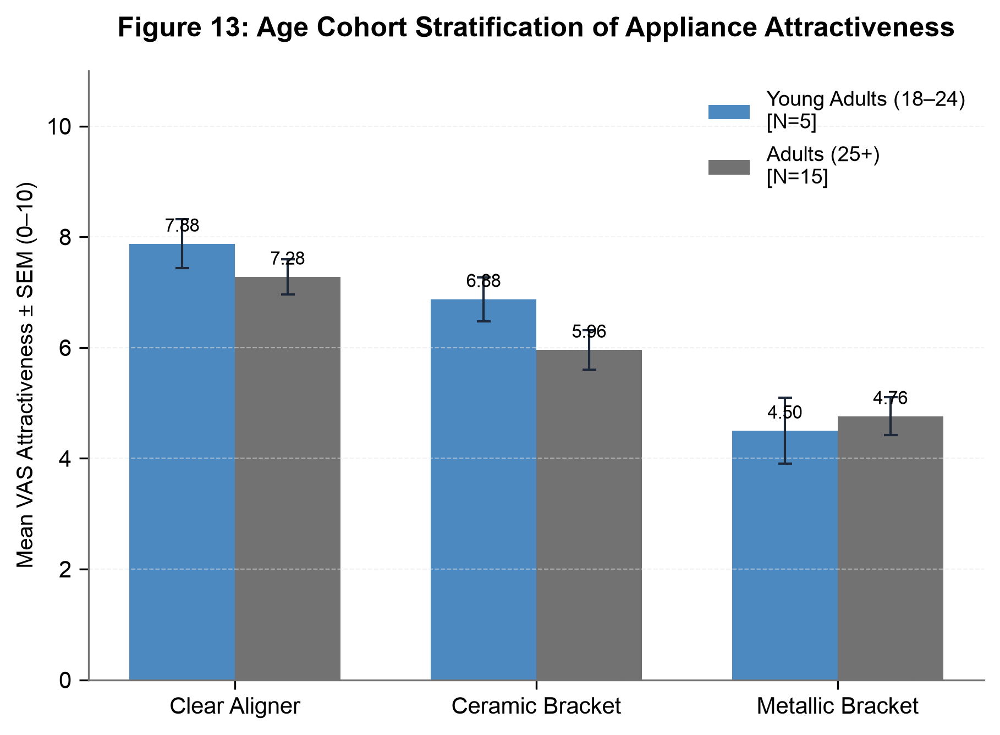

**Legend & Statistical Interpretation:** Clustered bar chart comparing young adults (18–24) versus mature working adults (25+) across appliance modalities.

---

### Figure 14: Subgroup Contrast: Laypeople vs Dental-Affiliated Evaluators
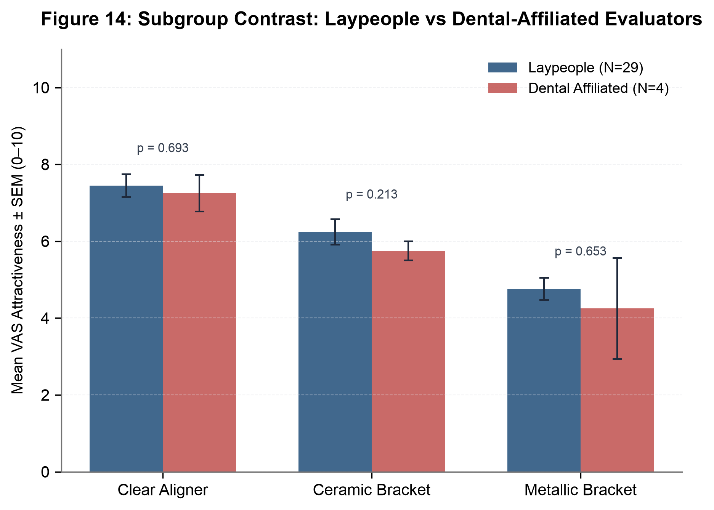

**Legend & Statistical Interpretation:** Clustered bar comparison with Mann-Whitney U test p-values testing whether dental professionals/students evaluate appliance aesthetics more critically than the general public.

---

### Figure 15: Cumulative Acceptance Curves Across Aesthetic Thresholds (CDF-Style)
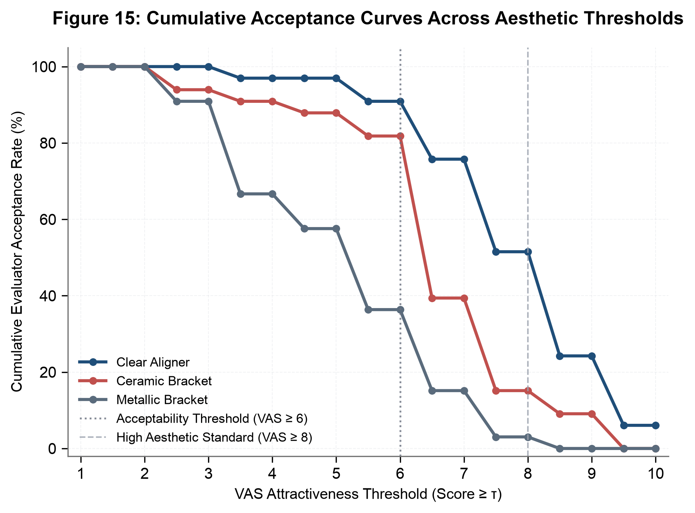

**Legend & Statistical Interpretation:** Step/survival-style curves showing the percentage of respondents rating each appliance at or above escalating aesthetic cutoff levels (VAS ≥ 1 to 10), marking clinical acceptability and high aesthetic standards.

---

